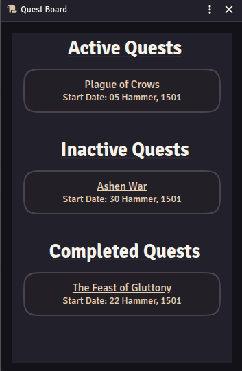

Love using Calendaria, but hate digging through all your notes to find your quests?
Search no more with Quest Collector!

This module collects all your notes with the Quest Preset and filters them into one window for easy display!

GM's you can see all quests seperated by visibility, all quest notes marked as Visible are sorted into the "Active Quests" category

Players only see the active quests! Keeping the secret quest notes secret!

Use the included "Completed Quests" note Preset to recatagorze visible completed quests so they dont clutter the active bar.

